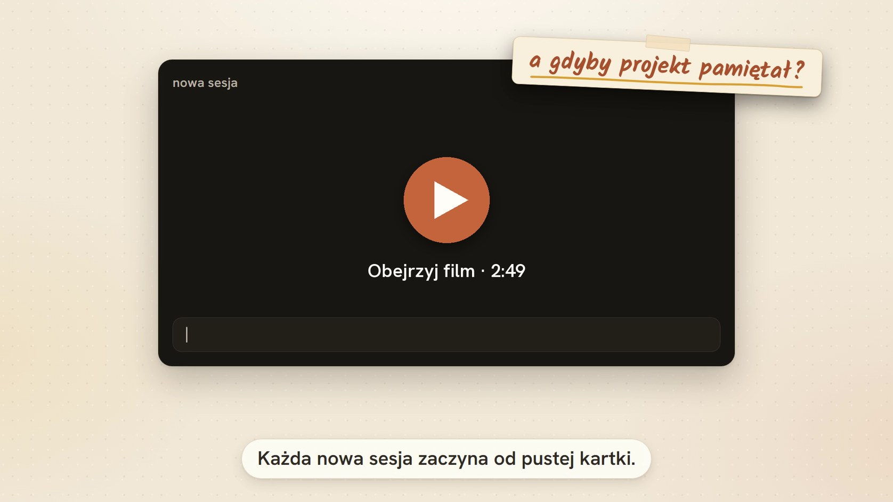

<p align="center">
  
</p>

<p align="center">
  <em>Wersja 3.2.0 &nbsp;·&nbsp; licencja MIT &nbsp;·&nbsp; Claude Code, Cursor albo Codex, plus Node.js 14+ &nbsp;·&nbsp; zero zależności npm</em>
</p>

**RelAI zamienia rozmowę z agentem w prowadzony projekt.** Ustalenia, decyzje, stan prac i historia
zostają w plikach obok kodu, a nie w kontekście sesji, który za chwilę zniknie. Nowa sesja zaczyna
od przeczytania, gdzie naprawdę jest praca, zamiast pytać Cię od nowa.

**Strona:** [nowilus.github.io/relai](https://nowilus.github.io/relai/) w dwóch wersjach — jako
[film](https://nowilus.github.io/relai/pl/) i jako [biurko 3D](https://nowilus.github.io/relai/pl/biurko/).
Która lepiej pokazuje, czym jest RelAI? [Ankieta, 1 minuta](https://tally.so/r/BE4lQ5?wersja=readme&jezyk=pl).

## Instalacja i pierwsze kroki

**Claude Code** — dwie komendy w terminalu, raz na maszynę:

```bash
claude plugin marketplace add nowilus/relai
```

```bash
claude plugin install relai@relai
```

Potem otwórz Claude Code w folderze projektu i napisz na przykład:

```text
zacznijmy projekt
```

RelAI zapyta o zgodę, zada **trzy pytania** naraz (język, git, rodzaj projektu — każdy rodzaj
z jednym zdaniem objaśnienia) i założy osiem plików: `CLAUDE.md`, `README.md` oraz w `docs/` stan,
dziennik, lekcje, decyzje, ustawienia i ściągę komend. Od tej chwili piszesz normalnie — dokumenty
aktualizują się w ramach pracy.

Odmowa jest ostateczna: w tym folderze RelAI więcej się nie zaproponuje. Plugin działa w każdym
folderze na koncie, ale pliki powstają wyłącznie tam, gdzie się zgodzisz.

**Cursor i Codex** instalują się inaczej (adapter per projekt, plugin z repozytorium) — instrukcja
krok po kroku i aktualizacja dla wszystkich trzech narzędzi: [docs/INSTALACJA.md](docs/INSTALACJA.md).

**Gdzie RelAI nie działa:** w claude.ai (czat w przeglądarce i w aplikacji) ani przez API Claude.
Pamięć projektu stoi na hookach, komendach i plikach w folderze projektu — tego tam nie ma, także
gdy skill wgrasz ręcznie jako Agent Skill.

**Masz już projekt?** `/relai-adopt` przenosi go na strukturę RelAI: najpierw pełny backup, potem
plan zmian do Twojej zgody; kod zostaje nietknięty.

## Zobacz, jak to działa

<p align="center">
  <a href="https://nowilus.github.io/relai/pl/wideo/"></a>
</p>

Film (2 min 49 s, z muzyką) pokazuje RelAI w pracy: paski nad promptem, panel z przyciskami
zamiast komend i start etapu w nowej sesji. Wersja z angielskimi napisami:
[nowilus.github.io/relai/wideo](https://nowilus.github.io/relai/wideo/).

## Na co dzień

Trzy zdania wystarczą do większości pracy:

| Powiesz | Co się stanie |
|---|---|
| „kontynuujemy pracę" | RelAI czyta dokumenty, mówi, gdzie jesteśmy, i proponuje najbliższy krok |
| „sprawdź status" | krótki raport: stan, plany, otwarte ryzyka, zaległości w dokumentach |
| „kończymy na dziś" | dokumenty zsynchronizowane, wpis do dziennika, ryzyka odświeżone, propozycja commita |

„Przygotuj plan…" daje plan jako osobny dokument: warianty, ryzyka, etapy, przypadki brzegowe. Po
akceptacji plan jest zamrożony, a `/relai-stage` uruchamia kolejny etap — zawsze po Twoim „tak".

Szesnaście komend `/relai-*` to skróty rzadszych operacji (backup, audyt, przekazanie projektu,
optymalizator promptów, humanizacja tekstu, skan zależności…). Pełna lista: `/relai-help` albo [przewodnik](docs/PRZEWODNIK.md#komendy).
W Claude Code komendy mają pełną nazwę `/relai:relai-<nazwa>`.

## Panel w Claude Code (early access)

Cztery osobne pluginy z tego samego marketplace rysują RelAI w oknie Claude Code. Działają na
**modach**, czyli API Claude Code oznaczonym jako „early access”. To API może się zmienić bez
zapowiedzi i wtedy panel przestanie się ładować. Zmierzone na wersjach 2.1.293–2.1.295 (`relai-mods`
na 2.1.308), na desktopie i w terminalu.

| Plugin | Co pokazuje |
|---|---|
| `relai-panel` | nad promptem: aktywny plan, etap i status, a wiersz „Tak / Nie” tylko, gdy karta decyzji czeka; `/relai-panel` otwiera panel z sekcją „Teraz” (stan punktów widać po kształcie znaczników, cały punkt w dymku po najechaniu), formularzami piętnastu komend, mapą planów i etapów, dokumentami projektu ze zmianami od commita i kosztami sesji. Na desktopie start etapu z karty otwiera nową sesję aplikacji z komendą w polu — jeden Enter, a rozmowa, w której kliknąłeś, zostaje |
| `relai-progress` | nad promptem: lista kroków etapu w toku albo przebiegu `/relai-crew` — cienkie segmenty ze zrobionymi od lewej, jedna linia z punktem w toku i „Rozwiń”, chip agentów; `/relai-agents` — subagenci sesji z kosztem |
| `relai-cache-keeper` | nad promptem: cztery baterie w równej siatce — czas cache promptu, limit 5 h, czas do jego resetu, limit tygodniowy — pełne słowa w dymku aplikacji, i wiersz kontekstu „użyte / okno modelu · %” z kreską progu auto-compactu (z `CLAUDE_AUTOCOMPACT_PCT_OVERRIDE`) i barwą liczoną do progu; koszt sesji; podpowiada, kiedy nowa sesja się zwróci (`/cache` pokazuje rachunek). Limit planu: progi 5 h (90 %) i tygodnia (98 %) z podpisem pod baterią, karta „pracuję dalej / zapisz pracę” po turze ponad progiem, a po resecie „Wznów pracę” — czysty czat od pliku wznowienia. Progi zmieniasz w panelu, zakładka Koszty |
| `relai-mods` (0.1.1) | `/relai-mods` otwiera kokpit modów, pluginów i hooków z `settings.json` tej maszyny, czytany z dysku: przełącznik włącza albo wyłącza plugin przez `claude plugin` z PATH, a Przeładuj w terminalu przeładowuje od razu, na desktopie prosi o wpisanie `/reload-plugins`. Hooki, pluginy z polityki i sam kokpit mają kłódkę; kokpit nie pisze do plików ustawień |

Paski i panel idą same za wyglądem aplikacji, jasnym albo ciemnym: tekst i ramki w kolorach
narzędzia, panel na jednej kartce z palety Warsztat. Przełączać niczego nie trzeba.

Każda zmiana stanu z panelu (start etapu, sprzątanie, aktualizacja) idzie przez kartę „Tak / Nie”.
Panel nie woła modelu. Jedyny ruch sieciowy we wszystkich czterech to odczyt strony cennika Anthropic, i to
dopiero po „Tak” na karcie aktualizacji cennika. W podziale okna (dwie albo trzy sesje obok
siebie, także jedna nad drugą) każda sesja ma własne paski i własny `/relai-panel`. Etap
uruchomiony z karty w nowej sesji możesz więc otworzyć obok bieżącej rozmowy (przeciągnij ją
z paska bocznego na krawędź okna albo w menu sesji wybierz Open in → Split view). Każda z nich
pokazuje swój plan, postęp i koszt. Instalacja: po komendach z „Instalacji” powyżej, każdy
plugin osobno:

```bash
claude plugin install relai-panel@relai
```

```bash
claude plugin install relai-progress@relai
```

```bash
claude plugin install relai-cache-keeper@relai
```

```bash
claude plugin install relai-mods@relai
```

Potem uruchom aplikację ponownie. Poza projektem RelAI paski milczą.

## Zanim zaczniesz: jakość zależy od modelu

RelAI to w większości instrukcje dla modelu. Kryterium odbioru są modele klasy **`strong`**
i **`balanced`** z listy narzędzia (dziś w Claude Code: Opus 5.5, Fable 5.1, Sonnet 5). Na słabszych
modelach pamięć projektu zostaje w plikach, a sygnały startu niesie hook, ale procedury bywają
niepełne — rytuał skrócony, skill niewyzwolony. Adopcję istniejącego projektu i etapy planu
prowadź na modelu `strong`.

## Co pilnuje tylko Claude Code

Twarde mechanizmy to **hooki** — skrypty uruchamiane przez narzędzie, nie przez model. Claude Code
ma ich jedenaście; Cursor i Codex po części. Tam, gdzie hooka nie ma, zasada stoi wyłącznie na
pamięci modelu — reguła w kontekście, bez blokady.

| Hook Claude Code | Co robi | Cursor | Codex |
|---|---|---|---|
| `secret-scanner` | blokuje zapis klucza do pliku śledzonego przez gita | hook | hook |
| `config-protection` | zmiana reguł projektu lub ustawień wraca jako pytanie; konfiguracja produkcyjna wymaga kopii stanu | reguła | tylko pamięć modelu |
| `session-context` | na starcie: data, rytuał startu, wersja, sygnały wymagające reakcji | hook | hook |
| `doc-sync-reminder` | zmiana kodu bez wpisu do dziennika kończy się przypomnieniem | reguła | przypomnienie na końcu sesji |
| `journal-signature` | pilnuje formatu podpisu wpisu dziennika | tylko pamięć modelu | tylko pamięć modelu |
| `profile-rules` | pierwszy plik kodu, ekran czy wdrożenie tworzy właściwy dokument | reguła | tylko pamięć modelu |
| `prompt-mode` | tryb ciągły optymalizatora promptów i jego pytanie o zgodę | brak trybu | brak trybu |
| `quality-gate` | `tsc` i eslint po edycji, gdy projekt je ma | brak | brak |
| `console-log-warn` | ostrzega o `console.log` w zapisanym pliku | brak | brak |
| `design-quality-check` | sygnalizuje odstępstwo od `docs/DESIGN.md` | brak | brak |
| `auto-format` | Prettier na zmienionych plikach, gdy projekt go ma | brak | brak |

Poza projektem RelAI każdy hook milczy. Commit z sekretem zatrzymuje w każdym narzędziu opcjonalny
gitowy pre-commit — [przewodnik](docs/PRZEWODNIK.md#skan-sekretów-przy-commicie-opcjonalny-poza-harnessem).

## Słowniczek

| Pojęcie | Znaczy |
|---|---|
| **hook** | skrypt, który narzędzie uruchamia samo przy zdarzeniu (start sesji, zapis pliku) — działa bez względu na to, co pamięta model |
| **skill** | plik z procedurą, który model wczytuje, gdy temat rozmowy do niego pasuje |
| **etap** | część planu wykonywana w jednej świeżej sesji według gotowego promptu |
| **aneks** | datowana zmiana zamrożonego planu — plan nie jest przepisywany po cichu |
| **odnoga** | boczny wątek odłożony z etapu na osobną kartę z promptem dla świeżej sesji (`/relai-branch`) |
| **rotacja** | przeniesienie najstarszej historii z dziennika czy lekcji do `docs/archiwum/` — w całości, z linkiem |
| **D-NN** | numer decyzji w `docs/DECYZJE.md` (np. D-90); decyzja zamrożona nie wraca jako propozycja |
| **L-NNNN** | numer lekcji w `docs/LEKCJE.md` — Twojej korekty zapisanej jako zasada pracy |

## Dalej

- [Plan panelu Codeksa](docs/plany/PANEL_CODEX/PLAN.html) — pełny zakres GUI, tokenów i kosztów;
  osobny plan do akceptacji, realizowany po PANEL_CLAUDE.
- [Przewodnik](docs/PRZEWODNIK.md) — co RelAI robi i czego nie robi, komendy, plany, dowody działania,
  struktura repozytorium, konwencje hooków.
- [Instalacja i aktualizacja](docs/INSTALACJA.md) — Claude Code, Cursor, Codex.
- [Przenośność](docs/PRZENOSNOSC.md) — co Cursor i Codex realnie dają.
- [Wywiad o panelu wizualnym](docs/zasoby/PANEL_RELAI/WYWIAD.md) — uzgodnione wymagania nowego
  obszaru rozwoju, przed przygotowaniem i akceptacją planu.

<details>
<summary><strong>English summary</strong></summary>

RelAI is a documentation-first process framework for Claude Code, Cursor and Codex. Your project's
state, decisions, lessons and plans live in plain Markdown files next to the code, so every new
session starts by reading where the work actually is. Install with
`claude plugin marketplace add nowilus/relai` and `claude plugin install relai@relai`, open a project
folder and say "start project". Documentation is generated in the project's language; this README
and the plugin's own docs are Polish.

</details>

## Feedback

RelAI jest po pilotażu, ale przed spotkaniem z cudzymi nawykami pracy — i to jest teraz
najciekawsza część. Jeśli coś nie zadziałało, zadziałało inaczej niż się spodziewałeś albo
przeszkadzało: **nowakowskilukasznl@gmail.com**.

Najbardziej przydatne zgłoszenie zawiera wersję pluginu (`docs/USTAWIENIA.md` w Twoim projekcie),
model, na którym pracowałeś, oraz to, co miało się stać i co się stało zamiast tego.

## Licencja

MIT — patrz [LICENSE](LICENSE). Używaj, zmieniaj, wdrażaj u siebie, także komercyjnie. Bez żadnej
gwarancji.

Reguły `/relai-humanize` pochodzą z pluginu Humanizer (Siqi Chen, licencja MIT) — pliki, które
z nich korzystają, i pełny tekst licencji źródła: [nota](core/humanize/LICENSE-humanizer.md).

Pełny audyt `/relai-security --full` korzysta ze skilla `security-audit` od Cloudflare (licencja
MIT), dołączonego bez zmian jako kopia przypiętego commitu w
`adapters/claude-code/skills/security-audit/` — lista plików kopii, źródło i pełny tekst licencji:
[nota](adapters/claude-code/skills/security-audit/RELAI-NOTICE.md).
